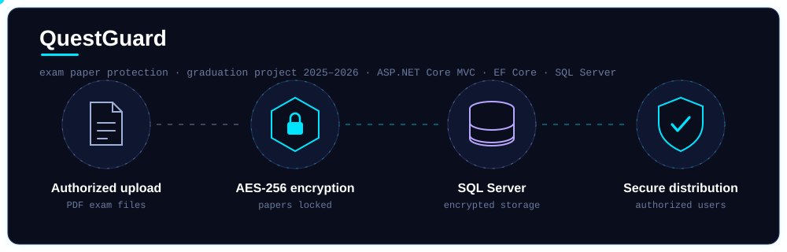

<!-- ضعه في repo اسمه 5jad (بعد تغيير المعرف بدّل 5jad بالمعرف الجديد بكل مكان) -->

 

  

 

 

## 🔐 Featured: QuestGuard

**Graduation project (2025–2026)** — a web system that protects ministerial exam papers from leaks by encrypting PDF files with **AES-256**. Authorized users can upload, encrypt, and distribute sensitive exam documents securely.

- Built with **ASP.NET Core MVC**, **Entity Framework Core**, and **SQL Server**
- Presented at the **4th Programming Expo, University of Kufa (2026)**
- 🔗 Repository: <QUESTGUARD_REPO_URL>

---

## 🚀 More Projects

| Project | What it does | Stack |
|:--|:--|:--|
| 🛒 [**soog-flutter-app**](https://github.com/5jad/soog-flutter-app) | Mobile e-commerce app connecting merchants with customers so they can publish products inside the app | Flutter · Dart |
| 📸 [**instagram-auto-poster**](https://github.com/5jad/instagram-auto-poster) | Pulls products from a wholesale platform's API and posts them to Instagram automatically | Python · REST APIs |
| 🐍 [**django-ecommerce-store**](https://github.com/5jad/django-ecommerce-store) | Full store: product listing, cart, user login, SQL database | Python · Django · Bootstrap |

---

<b>🏆 Expos & Competitions</b>

 

- **4th Programming Expo** — University of Kufa, 2026 · presented QuestGuard
- **AI Applications Expo** — Islamic University, 2025 · showcased an AI-based application
- **AI Image Generation Contest** — University of Kufa, 2024 · built and presented an image generation tool

<b>📚 Training & Workshops</b>

 

- **Software Development Course** — Code for Iraq, 2024
- **GDG Najaf Workshop** — Google Developer Group, 2024
- **Programming & Web Development Fundamentals** — The Code People (TCP), 2023

<b>🎓 Education</b>

 

**B.Sc. Computer Technology Engineering** — Al-Kafeel University, 2022–2026
Focus: software development, web systems, cybersecurity fundamentals

---

<picture>
  <source media="(prefers-color-scheme: dark)" srcset="https://raw.githubusercontent.com/5jad/5jad/output/github-snake-dark.svg"/>
  
</picture>

 

